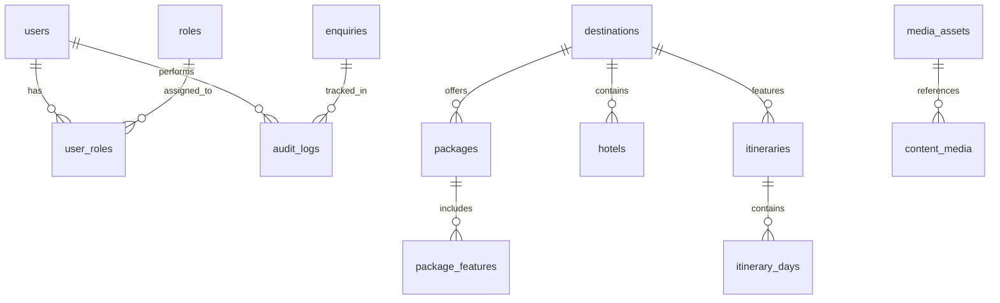

# Galaxy Heritage World — Database Schema Design

Engine: **MySQL 8.0**  
ORM: **Prisma ORM**  
Design: Fully normalized relational tables with referential integrity, indexes, soft deletion flags, and timestamps.

## Entity Relationship Diagram (Mermaid)

## Table Definitions

### 1. `users`
- `id` VARCHAR(36) PRIMARY KEY
- `email` VARCHAR(191) UNIQUE NOT NULL
- `password_hash` VARCHAR(255) NOT NULL
- `name` VARCHAR(191) NOT NULL
- `phone` VARCHAR(30)
- `is_active` BOOLEAN DEFAULT TRUE
- `created_at` DATETIME(3) DEFAULT CURRENT_TIMESTAMP(3)
- `updated_at` DATETIME(3) ON UPDATE CURRENT_TIMESTAMP(3)

### 2. `roles` & `user_roles`
- Standard RBAC table supporting: `SUPER_ADMIN`, `ADMIN`, `EDITOR`, `SALES`, `SUPPORT`.

### 3. `destinations`
- `id` VARCHAR(36) PRIMARY KEY
- `slug` VARCHAR(191) UNIQUE NOT NULL
- `name` VARCHAR(191) NOT NULL
- `region` VARCHAR(100) NOT NULL (e.g. North India, South India, Rajasthan, International)
- `country` VARCHAR(100) DEFAULT 'India'
- `type` ENUM('DOMESTIC', 'INTERNATIONAL') DEFAULT 'DOMESTIC'
- `description` TEXT NOT NULL
- `tagline` VARCHAR(255)
- `hero_image_url` VARCHAR(500)
- `featured` BOOLEAN DEFAULT FALSE
- `is_published` BOOLEAN DEFAULT TRUE
- `meta_title` VARCHAR(255)
- `meta_description` TEXT
- `created_at` DATETIME(3) DEFAULT CURRENT_TIMESTAMP(3)
- `updated_at` DATETIME(3) ON UPDATE CURRENT_TIMESTAMP(3)

### 4. `hotels` (Resorts & Properties)
- `id` VARCHAR(36) PRIMARY KEY
- `slug` VARCHAR(191) UNIQUE NOT NULL
- `name` VARCHAR(191) NOT NULL
- `destination_id` VARCHAR(36) FOREIGN KEY REFERENCES `destinations(id)`
- `location_name` VARCHAR(191) NOT NULL (e.g. Goa, Mussoorie, Amritsar)
- `rating_stars` INT DEFAULT 4
- `image_url` VARCHAR(500) NOT NULL
- `gallery` JSON
- `amenities` JSON
- `description` TEXT
- `is_associated` BOOLEAN DEFAULT TRUE
- `featured` BOOLEAN DEFAULT FALSE
- `is_published` BOOLEAN DEFAULT TRUE
- `created_at` DATETIME(3) DEFAULT CURRENT_TIMESTAMP(3)
- `updated_at` DATETIME(3) ON UPDATE CURRENT_TIMESTAMP(3)

### 5. `packages` & `package_features`
- `id` VARCHAR(36) PRIMARY KEY
- `slug` VARCHAR(191) UNIQUE NOT NULL
- `title` VARCHAR(255) NOT NULL
- `destination_id` VARCHAR(36) FOREIGN KEY REFERENCES `destinations(id)`
- `duration_nights` INT NOT NULL
- `duration_days` INT NOT NULL
- `price_starting` DECIMAL(10, 2)
- `hero_image_url` VARCHAR(500)
- `overview` TEXT
- `inclusions` JSON
- `exclusions` JSON
- `featured` BOOLEAN DEFAULT FALSE
- `is_published` BOOLEAN DEFAULT TRUE

### 6. `itineraries` & `itinerary_days`
- Structured itineraries with day-by-day titles, activities, meals, and accommodations.

### 7. `activities`
- Day outings, picnic options, and adventure experiences with pricing, location, and durations.

### 8. `media_assets`
- `id` VARCHAR(36) PRIMARY KEY
- `filename` VARCHAR(255) NOT NULL
- `original_url` VARCHAR(500)
- `storage_path` VARCHAR(500) NOT NULL
- `mime_type` VARCHAR(100) NOT NULL
- `file_size` INT
- `alt_text` VARCHAR(255)
- `width` INT
- `height` INT
- `category` VARCHAR(100)
- `created_at` DATETIME(3) DEFAULT CURRENT_TIMESTAMP(3)

### 9. `enquiries`
- `id` VARCHAR(36) PRIMARY KEY
- `reference_number` VARCHAR(50) UNIQUE NOT NULL (e.g. `GHW-ENQ-1001`)
- `name` VARCHAR(191) NOT NULL
- `email` VARCHAR(191) NOT NULL
- `phone` VARCHAR(30) NOT NULL
- `city` VARCHAR(100) NOT NULL
- `age_group` VARCHAR(20)
- `destination_interest` VARCHAR(191)
- `package_interest` VARCHAR(191)
- `travel_dates` VARCHAR(100)
- `travelers_count` INT
- `message` TEXT
- `status` ENUM('NEW', 'CONTACTED', 'QUALIFIED', 'CONVERTED', 'CLOSED', 'SPAM') DEFAULT 'NEW'
- `consent` BOOLEAN DEFAULT TRUE
- `ip_address` VARCHAR(45)
- `user_agent` VARCHAR(255)
- `notes` TEXT
- `created_at` DATETIME(3) DEFAULT CURRENT_TIMESTAMP(3)
- `updated_at` DATETIME(3) ON UPDATE CURRENT_TIMESTAMP(3)

### 10. `faqs`, `testimonials`, `site_settings`, `audit_logs`
- Complete support for FAQ accordions, verified customer testimonials, customizable key-value settings, and immutable administrative audit logging.
